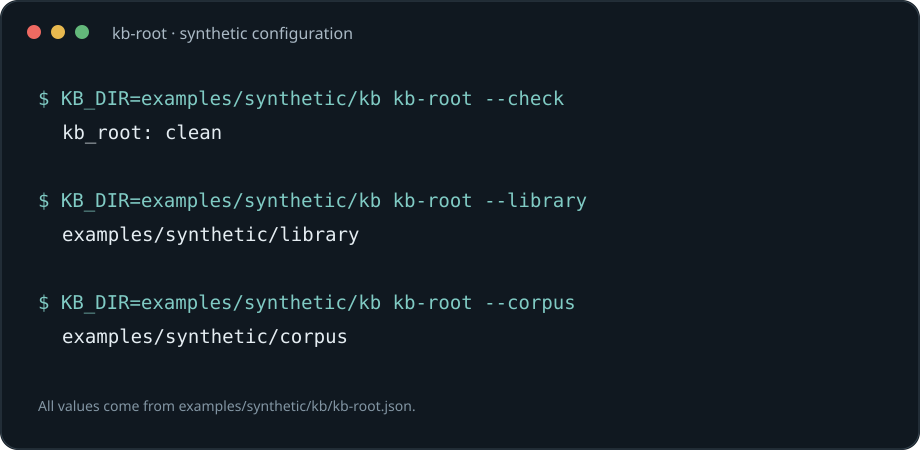

kb-root resolves a knowledge base's configured directories and checks that their paths stay consistent.



## Install

```sh
cargo install --git https://github.com/davidawad/kd-library-tooling
```

## Usage

Set `KB_DIR` to the directory containing `kb-root.json` (it defaults to the current directory):

```sh
KB_DIR=examples/synthetic/kb kb-root --check
KB_DIR=examples/synthetic/kb kb-root --library
KB_DIR=examples/synthetic/kb kb-root --corpus
```

The included synthetic configuration has a root at `examples/synthetic`; the check confirms that the root exists, the configured corpus is inside it, and the overlay default agrees with the root.

## License

GPL-3.0-or-later. See [LICENSE](LICENSE).
